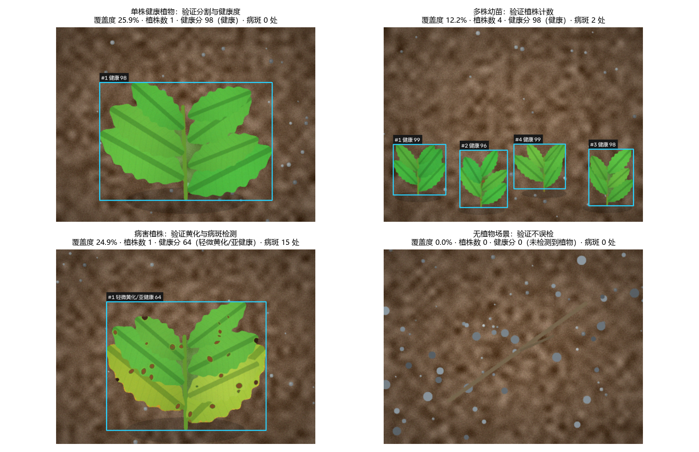

# 植物检测小项目（PlantDet）

一个**不需要训练模型、不需要下载权重**的植物检测项目：给它一张照片，它会告诉你画面里
有没有植物、大概有几株、长得好不好。

它做四件事：

1. **植被分割** —— 把植物从土壤、石头、桌面等背景里抠出来；
2. **植株计数** —— 统计画面里的植株（连通区域）数量与位置；
3. **长势评估** —— 计算绿色/黄化/坏死像素比例，给出 0~100 的健康分与结论；
4. **病斑检测** —— 找出叶片上褐斑、黑斑的个数和面积占比。

技术路线是经典的**颜色特征 + 形态学 + 连通域分析**，不依赖深度学习：
优点是快（单张图几十毫秒）、可解释（每一步都能看到中间结果）、对光照变化不敏感；
代价是对"绿色伪装物"和严重遮挡的场景不如深度学习稳。适合作为入门项目，
也可以当成深度学习方案之前的快速基线。



---

## 一、快速开始

```bash
# 1) 安装依赖（只有三个）
pip install -r requirements.txt

# 2) 一键演示：自动生成示例图片 -> 跑检测 -> 输出报告和总览图
python run_demo.py

# 3) 检测自己的照片
python -m plantdet -i 你的照片.jpg -o results
python -m plantdet -i 某个文件夹 -o results        # 批量处理
```

跑完在 `results/` 目录里会得到：

| 文件 | 内容 |
| --- | --- |
| `xxx_detected.png` | 标注图：绿色=植物，红色=疑似病斑，方框=检测到的植株 |
| `xxx_mask.png` | 植被掩膜（白=植物） |
| `xxx_figure.png` | 原图 / 掩膜 / 结果 三联对比图 |
| `xxx_report.json` | 结构化报告，含每个区域的完整指标 |
| `summary.csv` | 批量处理的统计表（一键演示时生成） |
| `summary_board.png` | 四张示例图的结果总览 |

命令行还支持调参，例如光照偏暗时放宽亮度下限：

```bash
python -m plantdet -i 图片.jpg --val-min 20 --sat-min 30 --yellow-connect 20
```

## 二、网页版演示（免安装）

双击打开 `webdemo/index.html` 即可。它把同一套算法用 JavaScript 重写了一遍，
可以拖拽上传自己的照片、实时拖动滑块调参、直接看掩膜和每个区域的指标，图片全程不离开本机。

- 点击「载入示例」可以看四种典型场景；也支持把截图直接粘贴进去。
- 想快速判断"是分割不对还是照片本身有问题"时，勾选「只看掩膜」最直观。

## 三、项目结构

```
plant-detector/
├── plantdet/                 算法包
│   ├── segment.py            第 1 步：ExG + Otsu + HSV 分割出植被
│   ├── analyze.py            第 2 步：连通域统计 + 健康度/病斑评估
│   ├── visualize.py          第 3 步：画掩膜、方框、三联对比图
│   ├── report.py             第 4 步：控制台表格 + JSON 报告
│   ├── pipeline.py           串起整条流水线（也在这里读写图片）
│   └── cli.py                命令行入口
├── scripts/make_demo_images.py   合成示例图片（没有照片也能跑）
├── webdemo/index.html            纯前端演示版
├── run_demo.py                   一键演示脚本
├── samples/                      示例图片
└── results/                      检测结果
```

## 四、算法原理（分四步）

### 第 1 步：植被分割 `segment.py`

**ExG 超绿指数。** 把像素换算成色度坐标（各自除以 R+G+B），再算

```
ExG = 2g - r - b        （g、r、b 为归一化后的绿色、红色、蓝色分量）
```

绿色植物这个值明显为正，土壤、石头、灰色物体接近 0 或为负。因为做了归一化，
整体明暗（白天/阴天）对它影响很小。

**Otsu 自动阈值。** 不手工指定"大于多少算植物"，而是用 Otsu 算法在 ExG 图上
自动找分割点：让前景类内部方差 + 背景类内部方差之和最小，等价于把直方图的双峰分开。
需要更严格时用 `--exg-bias` 微调。

**HSV 颜色区间交叉验证。** 光靠 ExG 会把偏黄绿的土块也拉进来，所以再要求像素
同时落在绿色色相区间（H 25~95）且饱和度、亮度达标，两个条件取交集。

**黄叶的单独通道。** 发黄、失绿的叶片颜色已经偏离绿色区间，如果直接排除，
"黄化"这个最重要的病害信号就消失了。这里的做法是：黄叶用单独放宽的阈值挑出来，
但**只有与绿色主体相接的整片黄叶才被接纳**（按连通域判断，接触容差可调）。
这样既能把黄叶纳入统计，又不会把孤立土块、枯枝误检成植物。

**形态学清理。** 开运算去掉零星噪点，闭运算补上叶片里的缝隙，再删除面积过小的碎块，
最后用外轮廓填充叶片内部的小孔洞，得到干净的掩膜。

### 第 2 步：区域分析 `analyze.py`

对掩膜做 8 邻域连通域分析，每个连通域视为"一株植物/一簇叶片"，统计面积、外接框，
并把区域内的像素分成三类：

| 类别 | 判定依据 | 含义 |
| --- | --- | --- |
| 健康绿 | H 30~95 且饱和度、亮度正常 | 正常叶片 |
| 黄化 | H 12~30、饱和度较高、亮度较高 | 缺素/缺水/衰老 |
| 病斑/坏死 | 亮度偏低或 ExG 为负（且不属于上面两类） | 褐斑、黑斑、干枯 |

病斑再单独做一次连通域统计，面积达标的才计为"一处病斑"（避免把叶缘噪声算进去）。

健康分按 100 分制加权：

```
健康分 = 100 × (绿色占比 + 0.5×黄化占比 + 0.15×病斑占比) - min(12, 病斑数×0.8)
```

即：黄化按一半折算，坏死几乎不算分，病斑数量额外扣分。等级划分为
**健康 ≥80 / 轻微黄化·亚健康 60~79 / 明显胁迫 40~59 / 疑似病害 <40**。

### 第 3、4 步：可视化与报告 `visualize.py` / `report.py`

掩膜和病斑半透明叠加在原图上，逐区域画外接框与结论；同时输出 UTF-8 的 JSON
（方便二次开发）和控制台表格（自己看）。

## 五、实测效果

四个场景的实测结果（图片由 `scripts/make_demo_images.py` 合成，可复现）：

| 示例 | 场景 | 覆盖度 | 植株数 | 健康分 | 病斑 | 结果 |
| --- | --- | --- | --- | --- | --- | --- |
| 01_healthy_plant | 单株健康植株 | 25.9% | 1 | 98 | 0 | 健康 |
| 02_seedlings | 多株幼苗 | 12.2% | **4（与真值一致）** | 98 | 2 | 健康 |
| 03_leaf_disease | 下部叶片黄化 + 叶面褐斑 | 24.9% | 1 | 64 | 15 | 轻微黄化/亚健康 |
| 04_no_plant | 土壤 + 石子 + 枯枝 | 0% | 0 | — | 0 | 未检测到植物 |

第 4 个样本是关键的反例：早期版本会把枯枝误检成"2 株胁迫植物"，
加入"黄叶必须与绿色主体相接"的约束后，覆盖度归零，不再误检。

速度方面（同一张图放大到不同分辨率后重复检测）：1280×960 约 0.2 秒、
1920×1440 约 0.4 秒、2560×1920 约 0.7 秒，且检测结论保持一致 —— 分辨率变化
不影响覆盖率与计数，说明基于比例的参数设计是稳的。

## 六、参数速查

| 参数 | 默认 | 什么时候要改 |
| --- | --- | --- |
| `--hue-min/--hue-max` | 25 / 95 | 植物偏黄绿（如新芽）可降到 20；偏深墨绿可提到 30 |
| `--sat-min` | 40 | 灰白背景误检多 → 调高；干燥发灰的作物漏检 → 调低 |
| `--val-min` | 30 | 逆光、阴影里的植物漏检 → 调低 |
| `--exg-bias` | 0 | 背景有大量黄绿色干扰 → 调正；植物颜色发暗漏检 → 调负 |
| `--min-area` | 0.0005 | 想忽略小杂草 → 调大（相对整图面积比例） |
| `--yellow-connect` | 15 | 黄叶与绿茎距离较远（如整叶枯黄）→ 调大；误检黄叶 → 调小或设 0 |

## 七、已知局限与下一步

**局限（都是连通域方法的固有特点）：**

1. 两株贴在一起的植物会被算成一个区域 —— 计数是"区域数"，不是严格的"株数"；
2. 严重遮挡、夜间补光、纯色背景前的绿色物体可能漏检或误检；
3. 黄化/病斑的阈值是经验值，换成完全不同的物种和光照最好重新标定。

**可以继续做的方向：**

1. 换成深度学习做实例分割（YOLO / Mask R-CNN），能解决重叠植株的计数问题；
   本项目的标注图和掩膜可以直接当预标注数据用；
2. 加一个时间序列维度：同一盆植物每天拍一张，输出黄化比例曲线，看长势趋势；
3. 用 `plantdet.analyze_image()` 作为函数接口接入摄像头或定时任务，做实时监测；
4. 用 `--out` 批量跑一个文件夹，`summary.csv` 直接能当实验记录表。

## 八、作为库调用

```python
from plantdet import analyze_path, analyze_image

result = analyze_path("leaf.jpg", out_dir="results")
print(result.summary["estimated_plant_count"], result.summary["mean_health_score"])
for region in result.regions:
    print(region.index, region.bbox, region.label, region.health_score)

# 也可以直接喂 numpy 数组（BGR），适合接摄像头
# result = analyze_image(frame)
```
